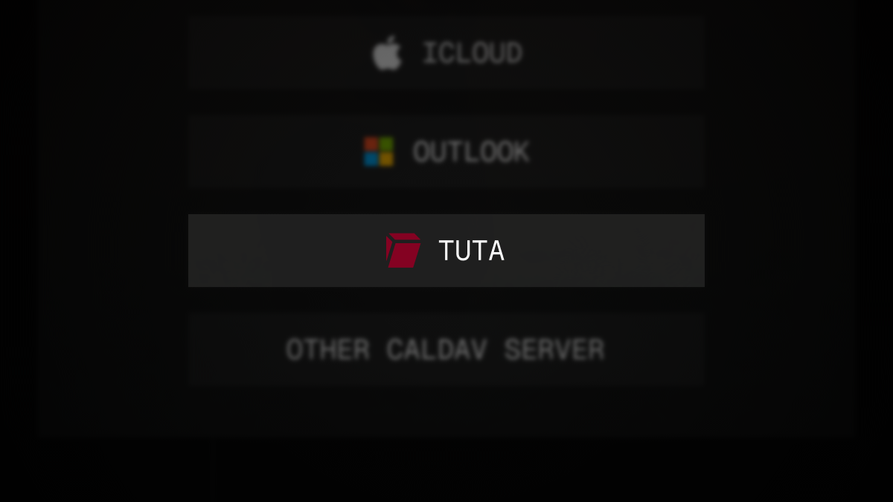

# caldir-provider-tuta

A [caldir](https://caldir.org) provider for [Tuta Calendar](https://tuta.com/calendar)



## renCal

If you use [renCal](https://rencal.org), install the [Tuta plugin](https://rencal.org/plugins/t4t5.tuta/) instead of following the steps below.

## Install

Install from GitHub:

```bash
cargo install --git https://github.com/t4t5/caldir-provider-tuta
```

<details>
<summary>Install from source</summary>

```bash
git clone https://github.com/t4t5/caldir-provider-tuta.git
cd caldir-provider-tuta
cargo install --path .
```

</details>

Prebuilt binaries for Linux and macOS are also available on the [releases page](https://github.com/t4t5/caldir-provider-tuta/releases).

`caldir-provider-tuta` should now be available on `PATH` for caldir to discover it.

## Connect

```bash
caldir connect tuta
```

Enter the email and password for your Tuta account to authenticate.

## How it works

The provider talks directly to Tuta's servers, like Tuta's own apps, and keeps end-to-end encryption intact:

- **Your password never leaves your machine.** It is stretched locally with Argon2, and only a verifier derived from it is sent to sign in.
- **Encryption happens locally**, using Tuta's open-source [Rust SDK](https://github.com/tutao/tutanota/tree/master/tuta-sdk/rust), vendored with a few small patches. Event details and reminders stay encrypted on Tuta's servers.
- **No third parties.** Only Tuta's servers are contacted. No telemetry or analytics.
- **No password stored after sign-in.** Only a session token and your encrypted passphrase key are kept, in owner-only files under `~/.config/caldir/providers/tuta/`. The key can only be decrypted with the session, so revoking it in Tuta makes the stored copy useless.

Keep in mind:

- caldir stores events as plain `.ics` files, so use full-disk encryption.
- To disconnect, revoke the session in Tuta's login settings and delete that folder.
- Events with attendees can be read but not edited, to avoid breaking invitations.
- This project isn't affiliated with Tuta and uses its undocumented SDK, which may change without notice.

## License

GPL-3.0
